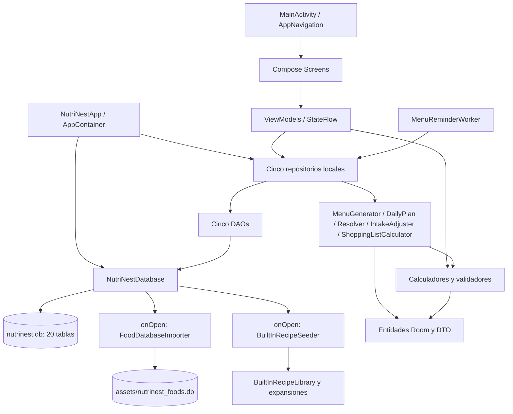

# 01 — Auditoría de arquitectura y línea base

Fecha: 2026-11-16 (Europe/Madrid). Alcance: inspección del código y ejecución de comprobaciones locales; sin implementación funcional. Repositorio identificado por el usuario: `Alexzame23/NutriNest`. El README no se ha utilizado para deducir capacidades.

## 1. Identidad y estado Git

| Referencia | SHA observado |
| --- | --- |
| Rama de trabajo `Development`, HEAD | `c3ff612004229d7d9c57a3fbff6bf7ad8ce405c2` |
| `origin/Development` local | `c3ff612004229d7d9c57a3fbff6bf7ad8ce405c2` |
| `master` local | `593a490fbb60ac06b63194573c6396aa6cd638f0` |
| `origin/master` local | `586529bd3d825ae3160520c25cc2a9a58e5e0d42` |
| Ancestro común HEAD / `origin/master` | `ac410f0755d0538a76dc1fbe9257f235990404e2` |

`git status --short --branch` inicial: `## Development...origin/Development`, sin cambios ni archivos nuevos no ignorados. `git diff --stat` y `git diff --cached --stat`: vacíos. No se han hecho fetch, checkout, merge, rebase, commit ni modificaciones del índice; las referencias remotas citadas son las disponibles localmente, no una certificación del estado actual de GitHub.

`git rev-list --left-right --count master...HEAD` devuelve `0 17`; `origin/master...HEAD`, `1 3`. `master` local aparece 15 commits por detrás de `origin/master`. En la divergencia con `origin/master`, el lado master contiene el merge `586529b`; Development contiene `56a1abd`, `aa865d2` y `c3ff612`. La diferencia desde el ancestro común (`git diff --stat origin/master...HEAD`) comprende 73 archivos, 1231 inserciones y 536 eliminaciones; no equivale a una comparación directa de ambas puntas.

Diferencias relevantes: preservación explícita de `meal_portions` durante la reconstrucción de `planned_meals`; borrados transaccionales de ingredientes y recetas; operaciones y consultas masivas de menú; correcciones de perfiles, ingestas e idiomas; nueva ayuda y recursos gráficos. El esquema sigue en v8. La reparación de la migración 5→6 beneficia a instalaciones que aún la ejecuten; no recupera automáticamente porciones que ya se hubieran perdido en una instalación previamente migrada.

Checkpoint recomendado, **no creado**: `docs: baseline architecture audit`.

## 2. Construcción y plataforma

| Ruta | Estado real |
| --- | --- |
| `settings.gradle.kts` | Proyecto `NutriNest`; único módulo `:app`; Google/Maven Central; Foojay resolver 1.0.0 |
| `build.gradle.kts` | Plugins Android application, Kotlin Compose y KSP, aplicados en app |
| `app/build.gradle.kts` | Namespace/applicationId `com.zame.nutrinest`; minSdk 26; compileSdk 36 minor 1; targetSdk 36; versionCode 1/versionName 1.0; Compose; Java source/target 11 |
| `gradle/libs.versions.toml` | AGP 9.2.1; Kotlin Compose 2.3.21; KSP 2.3.10; Room **biblioteca 2.8.4**; Compose BOM 2026.02.01; Navigation 2.8.5; Lifecycle 2.8.7; Coil 2.7.0; WorkManager 2.11.2; JUnit 4.13.2 |
| `gradle/wrapper/gradle-wrapper.properties` | Gradle 9.4.1; wrapper JAR y scripts incluidos en Git |
| `gradle/gradle-daemon-jvm.properties` | Daemon JVM 21; distinto del target de bytecode Java 11 |
| `gradle.properties` | Configuration cache; heap 2 GiB; opción experimental `android.r8.gradual.support=true` |
| `app/build.gradle.kts` | KSP exporta esquemas a `app/schemas`; androidTest los incluye como assets; release activa optimización; no separación de idiomas en el bundle |
| `app/src/main/AndroidManifest.xml` | `NutriNestApp`; `MainActivity` launcher exportada; permiso explícito POST_NOTIFICATIONS; locales configurados; sin permiso INTERNET declarado en este manifiesto fuente |

No hay módulos de dominio/datos separados, DI con Hilt, cliente de precios, autenticación o sincronización implementada en los repositorios examinados. Los campos `remoteId` y comentarios sobre nube son puntos de extensión, no integración operativa. No se ha auditado un manifiesto release fusionado ni se ha construido release.

`app/src/main/res/xml/backup_rules.xml` y `data_extraction_rules.xml` excluyen bases de datos e imágenes tanto del backup como, en el segundo archivo, de la transferencia entre dispositivos. `allowBackup=true` no significa que `nutrinest.db` esté respaldada.

## 3. Arquitectura real y dependencias

En las rutas abreviadas de esta sección, **S** significa exactamente `app/src/main/java/com/zame/nutrinest/`. El anexo de declaraciones enumera las rutas completas dentro del repositorio.

| Área | Rutas bajo S / clases y responsabilidad |
| --- | --- |
| Arranque y composición | `NutriNestApp.kt`: `NutriNestApp`, `AppContainer`; crea cinco repositorios locales y programa el recordatorio. `MainActivity.kt`: entrada Compose |
| Navegación | `navigation/AppNavigation.kt`: `Screen`, `AppNavigation`; home, ayuda, pestañas recetas/ingredientes, creación/detalle, perfiles, menú, compras e ingestas |
| Persistencia | `data/local/NutriNestDatabase.kt`: singleton Room, siete migraciones, callback de importación y seeding al abrir |
| Ingredientes/referencias/recetas | `data/repository/Repositories.kt`: interfaces `IngredientRepository`, `FoodReferenceRepository`, `RecipeRepository` y sus implementaciones `Local*` |
| Perfiles | `data/repository/ProfileRepository.kt`: `ProfileRepository`, `LocalProfileRepository` |
| Menús | `data/repository/MenuRepository.kt`: `MenuRepository`, `LocalMenuRepository`, `MealScopeTarget`; orquestación y transacciones de sustitución/ingestas |
| DAO | `data/local/dao/IngredientDao.kt`, `FoodReferenceDao.kt`, `RecipeDao.kt`, `ProfileDao.kt`, `MenuDao.kt`: cinco DAOs; SQL y operaciones atómicas |
| Entidades | `data/local/entity/IngredientEntity.kt`, `FoodDataEntities.kt`, `RecipeEntity.kt`, `ProfileEntity.kt`, `MenuEntities.kt`, `IntakeEntity.kt`: 20 tablas, DTO de JOIN/relaciones y converters |
| Nutrición | `domain/nutrition/NutritionCalculator.kt`: `NutritionCalculator`, `NutritionTargets`, `NutritionNote`, `UnitConversions`; `MeasureConversions.kt`; `IngredientValidator.kt` |
| Planificación | `domain/planner/MenuGenerator.kt`: configuración, resultado, recetas planificables y generación; `DailyPlan.kt`, `MenuResolver.kt`, `ShoppingListCalculator.kt`, `IntakeAdjuster.kt`, `DietarySafety.kt` |
| Ingredientes UI | `ui/ingredients/IngredientsViewModel.kt` y `IngredientsScreen.kt`; pares ViewModel/Screen en `detail/`, `editor/`, `compare/`; `IngredientPresentation.kt` |
| Recetas UI | `ui/recipes/RecipesViewModel.kt`, `RecipesScreen.kt`, `RecipesAndIngredientsScreen.kt`; pares en `create/`, `detail/`; `RecipePresentation.kt`, `RecipeImagePresentation.kt` |
| Perfiles UI | `ui/profiles/ProfilesViewModel.kt`, `ProfilesScreen.kt`; `edit/ProfileEditorViewModel.kt`, `ProfileEditorScreen.kt` |
| Menús UI | `ui/menu/WeeklyMenuViewModel.kt`, `WeeklyMenuScreen.kt`; pares en `config/`, `detail/`, `intake/`; `config/LockedMealRecipeSearch.kt` |
| Compras UI | `ui/menu/shopping/ShoppingListScreen.kt` contiene también **ShoppingListViewModel**; no tiene archivo ViewModel separado |
| Soporte | `util/TextNormalizer.kt`, `LocalizedNumbers.kt`, `WeekUtils.kt`, `AppLocale.kt`, `ImageStorage.kt`; `notifications/MenuReminderWorker.kt`; pantallas `ui/home/`, `ui/help/`, componentes `ui/components/` y tema `ui/theme/` |
| Datos integrados | `data/local/FoodDatabaseImporter.kt`, `BuiltInRecipeSeeder.kt`, `BuiltInRecipeLibrary.kt`; expansiones `MediterraneanRecipeExpansion.kt`, `LowCalorieRecipeExpansion.kt`, `WorldRecipeExpansion.kt`, `BuiltInRecipeExpansionSupport.kt`; textos en `BuiltInRecipeTranslations.kt`, `BuiltInRecipeInstructionOverrides.kt` |



Es MVVM con inyección manual mediante `AppContainer` y factories; los flujos Room llegan a `StateFlow` con `stateIn`/`combine`/`flatMapLatest` y Compose los observa con ciclo de vida. No es una separación estricta de capas: dominio importa entidades Room y `NutritionCalculator.kt` incluye `R`/`StringRes`; el comentario que lo describe como totalmente libre de dependencias Android es demasiado amplio. Compras mezcla ViewModel y pantalla en un archivo.

## 4. Base de datos y migraciones

Base de usuario: **`nutrinest.db`**, esquema **8**, `exportSchema=true`, 20 entidades; sin fallback de migración destructiva en el builder. Esquemas versionados: `app/schemas/com.zame.nutrinest.data.local.NutriNestDatabase/4.json`, `5.json`, `6.json`, `7.json`, `8.json`. No hay exportaciones v1–v3. Hash de identidad v8: `ecc15b80d9b578168273e8a9dae8d66d`.

Todas las migraciones están en `S/data/local/NutriNestDatabase.kt` y registradas en `build()`:

| Migración | Transformación |
| --- | --- |
| 1→2 | Crea `profiles`, `weight_entries`, FK e índice del historial |
| 2→3 | Añade `weightLossRate`, default SQL temporal `MODERATE` |
| 3→4 | Reconstruye perfiles sin ese default; copia y restaura historial antes del DROP; crea menús, platos, porciones y compras |
| 4→5 | Amplía ingredientes, crea ocho tablas de referencia/detalle, elimina starters no personalizados sin referencias, mapea categorías y normaliza nombres en Kotlin |
| 5→6 | Scope y cursos; recipeId nullable; propietario y filas libres; copia/restaura porciones para evitar CASCADE; añade `baseFactor` y lo rellena desde `factor`; planes de perfil e ingestas |
| 6→7 | Recuperación parcial de v6 incompleta si falta `profile_meal_plans`; añade `coverImageCrop='CENTER'`, `quantityUnit='GRAM'`; elimina BEDCA:2494 solo sin referencias |
| 7→8 | Añade `recipes.nameEs` y `recipe_steps.textEs`, ambos opcionales |

El anexo de esquema contiene todas las columnas, PK, FK e índices exportados. Aspectos que importan para normalización:

- `IngredientEntity.categoryKey` se persiste como **`foodType`**. No existe tabla de alimento canónico distinta de ingrediente ni FK desde `foodType`/`aisleKey` a catálogos.
- No hay unicidad/índice de `ingredients.sourceKey` ni unicidad de `recipes.remoteId`. La lógica usa esos identificadores, pero el motor no garantiza su unicidad.
- `ingredient_nutrients` tiene PK `(ingredientId,tag)` y FK solo al ingrediente: `tag` no tiene FK a `nutrient_defs`.
- `recipe_ingredients` no admite dos filas del mismo ingrediente en una receta. Recetas y compras restringen el borrado del ingrediente; menú restringe el de receta.
- La unicidad de `recipes.name` es la del índice SQL; las comprobaciones de aplicación emplean `COLLATE NOCASE`. No son la misma semántica de comparación.
- No hay UNIQUE de posición lógica de plato ni de `(menuId,ingredientId)` en compras. Las garantías de una fila efectiva dependen de la aplicación.
- Los enums/converters y `slotsSpec`/`coursesSpec` guardan contratos textuales. Cambiar nombres de enums o claves de categorías es un cambio de datos, aunque no cambie el tipo SQL.
- Macros del ingrediente se guardan por 100 g; `intake_entries` embebe los mismos cuatro campos como cantidad total ingerida. No confundir las dos bases.

## 5. Flujos de cálculo y persistencia

### Ingredientes y unidades

`IngredientsViewModel → LocalIngredientRepository → IngredientDao`: búsqueda normalizada ES/EN y aliases; filtros de categorías/favoritos/custom; orden y presentación en UI. Se excluye `BEDCA:2494` de las consultas principales de catálogo, aunque un registro histórico referenciado puede seguir existiendo. El conteo por categorías de `FoodReferenceDao` no aplica esa exclusión.

`IngredientEditorViewModel.persist → repository.save → IngredientDao.upsertFull`: valida, normaliza nombres y guarda padre + nutrientes + porciones + aliases en transacción. Editar un importado mantiene su ID/sourceKey pero lo marca `isCustom=true`. Los hijos anteriores se borran y se insertan los nuevos; quality issues no se regeneran ahí. El editor conserva favoritos, uso, creación y ruta de imagen según corresponda.

`MeasureConversions` convierte masa directamente, volumen con densidad; líquido sin densidad usa 1 g/ml y sólido sin densidad no habilita volumen. Porciones domésticas son masas por ingrediente. `quantityUnit` conserva la presentación de una receta, **grams sigue siendo la magnitud canónica**. Compras muestra g o kg a partir de 1000 g. No hay conversión general crudo↔cocido, rendimiento de cocción, desperdicio, envase comercial ni precio.

### Recetas

`CreateRecipeViewModel.save → LocalRecipeRepository.create → RecipeDao.insertFullRecipe`: valida cantidades finitas positivas, ingredientes y pasos; transacción de cabecera, enlaces y pasos. `markUsed` ocurre después, fuera de esa transacción, y su fallo no convierte en fallida una receta ya guardada. Fotos se copian a `filesDir/images` con límite de 20 MiB; SQLite guarda rutas, no blobs; su gestión no es una transacción SQL.

Nutrición de receta = suma de `ingrediente.macros × grams / 100`. `RecipeDao.observeNutritionTotals` hace la suma SQL para listas; `IngredientWithQuantity.nutrition` y ViewModels la calculan para detalle. No hay snapshot nutricional de receta o plato: modificar la composición del ingrediente cambia las sumas posteriores, mientras las porciones persistidas pueden seguir calculadas con cifras anteriores. `RecipeDao.deleteIfUnused` y `IngredientDao.deleteIfUnused` comprueban referencias y borran dentro de transacción, respaldados por FK RESTRICT.

### Perfiles y objetivos

`ProfileEditorViewModel → LocalProfileRepository → ProfileDao`: creación atómica de perfil, peso inicial y distribución; edición añade historial solo si cambia el peso; reemplaza distribución cuando se aporta. Persistencia métrica (kg/cm), conversión imperial en UI. `NutritionCalculator.targetsFor` calcula BMR (AUTO selecciona Katch con grasa corporal o Mifflin sin ella; Katch explícito sin grasa cae a Mifflin), multiplica actividad, aplica objetivo y suelo de 1200 kcal del código, y redondea objetivos. Proteína por kg según objetivo, grasa 27% y carbohidratos restantes. Se describe la implementación; esta auditoría no valida clínicamente esas fórmulas.

`DailyPlan.of` combina distribución del perfil y pesos de fallback del menú. Las cuotas son absolutas y **no se renormalizan al liberar un slot**. El cálculo depende de la edad actual y de la zona/fecha del dispositivo; no se almacena un objetivo nutricional histórico.

### Generación, sustitución e ingestas

`MenuConfigViewModel.generate → LocalMenuRepository.generate`: carga perfiles, planes, recetas e ingredientes en consultas masivas; usa menú previo para variedad y compras previas como aproximación a sobrantes (no inventario real); conserva locks. Generador corre en `Dispatchers.Default` y combina restricciones, libros, categorías, repeticiones, afinidad, sobrantes y aleatoriedad. Es reproducible con `Random` inyectado, no con `Random.Default` entre ejecuciones. La exclusión de recetas recientes y el límite de repeticiones tienen fallback; no son restricciones duras en todos los casos.

`DietarySafety` filtra por nombres/categorías y texto libre de alergias/preferencias; se aplica contra la lista completa de perfiles antes de separar audiencias. No es un catálogo estructurado de alérgenos. Una receta bloqueada puede saltarse filtros de selección de libros/categorías mediante locks, pero debe pertenecer al conjunto elegible nutricional/dietético.

Factor de ración = `targetKcal / recipeKcal`, acotado a `[0.1,4.0]` (si receta <=0, helper devuelve 1). En éxito, `MenuDao.replaceMenu` elimina y reconstruye la semana atómicamente, con CASCADE de platos/porciones/compras. Se guardan factores y `baseFactor` iguales; se reinician marcas de compra al regenerar la semana. Los inputs para generar se leen antes de esa transacción: no constituyen un snapshot atómico de toda la generación.

`MenuResolver.forProfile` da precedencia a filas personales sobre compartidas por `(día,slot)` completo, incluidos sus cursos. `replaceMeal` opera dentro de `withTransaction`, puede separar el slot completo para una persona, recalcula sus porciones y reescribe compras conservando marcas por ingrediente. No invoca `DietarySafety`; el selector `MealDetailViewModel.allRecipes` observa todas las recetas.

`IntakeViewModel.log → LocalMenuRepository.logIntake`: guarda ingesta y reajusta el día en transacción; solo cambia `factor` del perfil. `IntakeAdjuster` usa `baseFactor`, energía ya ingerida, ingestas acumuladas y hora nominal de slots; excluye libres, no mueve comidas pasadas y acota factores a `[0.1,4]`. Al quedar el registro vacío restaura bases. No reescribe compras. Regenerar o reemplazar platos no reaplica automáticamente las ingestas existentes.

### Compras y otras persistencias

`ShoppingListCalculator` agrupa por **ingredientId**, no por nombre ni alimento equivalente: suma `grams de receta × suma de baseFactor del plato`. Slots sin receta no aportan. `shopping_items` materializa esa demanda; `ShoppingListViewModel` la agrupa por categoría (`foodType`), no por `shopping_aisles`, y solo modifica `purchased`. Dos ingredientes equivalentes con IDs distintos siguen siendo dos compras.

Borrar un perfil elimina por FK su historial, distribución, ingestas, filas personales y porciones, pero `LocalProfileRepository.delete` no recalcula `shopping_items`; editar un perfil tampoco recalcula porciones de semanas existentes. Son comportamientos observados que deben decidirse, no invariantes deseables que perpetuar.

`WeekUtils`: semanas a lunes 00:00 local; días como epoch millis de medianoche y ordinal 0–6; aritmética con Calendar para semanas. `MenuReminderWorker` consulta existencia del menú siguiente y programa trabajo periódico cerca del viernes 10:00; en cada arranque usa CANCEL_AND_REENQUEUE. Sus tests solo comprueban cálculo de fecha, no entrega real de notificaciones.

## 6. Asset, importador, biblioteca y tools

Asset versionado: `app/src/main/assets/nutrinest_foods.db`, 2 207 744 bytes, SHA-256 `66682591bb5ae18bd53f7b0d9f720718e3dd42abe81fc08a2d90e2141da90359`. Lectura SQLite en modo solo lectura. `dataset_version=2026.07.29`, esquema propio del asset `schema_version=1` (no Room v1). Tablas: `foods` 936, `food_macros` 936, `food_nutrients` 31696, `food_portions` 1309, `food_aliases` 1164, `food_quality_issues` 105, `food_categories` 12, `shopping_aisles` 14, `nutrient_defs` 81, `db_metadata` 18, más `sqlite_sequence` interna.

El importador filtra deprecated y food 2494: **923 alimentos**, 31337 nutrientes, 1306 porciones, 1163 aliases, 92 incidencias; estas cifras se ejecutaron y verificaron en el harness. Metadata conserva `search_backend=fts5` y conteo de `food_catalog_index`, aunque el asset distribuido ya no contiene esas tablas. Es metadata heredada, no descripción fiable de la estructura optimizada.

`FoodDatabaseImporter` copia el asset a cache, lo abre en conexión separada READONLY y escribe mediante sentencias preparadas sobre la conexión Room, sin ATTACH. **Copia y abre el asset antes de comparar versiones**, por lo que el comentario de «un lookup por arranque» no refleja todo el trabajo real. Si cambia versión, transacción: captura favorito/uso/foto; limpia catálogos; elimina importados no editados ni referenciados; copia datos con IGNORE/deduplicación; restaura estado; reserva secuencia de IDs y escribe versión/fecha. Importados: ID `1_000_000 + food.id`; nuevos usuarios después de reservar secuencia 2 000 000. Un ingrediente referenciado conserva cifras antiguas frente a refresh; los hijos de filas retenidas pueden recibir datos nuevos ausentes. No representa una actualización uniforme del catálogo. Fallos se registran y se absorben; no hay estado de fallo expuesto por repositorio.

`BuiltInRecipeSeeder` se ejecuta después. Biblioteca v3, meta `built_in_recipe_library_version`; 250 recetas verificadas por test unitario, tres libros. Resuelve IDs mediante `BEDCA:<id>`; identifica recetas con `remoteId=builtin:<key>`. Inserta en transacción o actualiza `nameEs`, reemplaza pasos/enlaces en recetas existentes conservando ID/favorito. Usa sufijos ante choque de nombre. Si no hay alimentos, aplaza; si faltan solo algunos o hay colisiones, omite recetas con warnings **y aun así fija versión 3**, sin reintento hasta cambio de versión/marker. Cambiar cantidades de biblioteca puede alterar recetas ya usadas en menús sin reconstruir sus compras.

| Script | Lo que hace / ejecución en esta fase |
| --- | --- |
| `tools/build_food_asset.py` | Requiere DB fuente externa; elimina FTS/catálogo/índices, deriva nombre normalizado y raw_safety con heurísticas, VACUUM y genera asset. Leído; no ejecutado para no modificar assets |
| `tools/ksql.py` | Parser parcial de strings/execSQL/CopyStep Kotlin para harness; no ejecuta Kotlin ni sus ramas de control |
| `tools/verify_migration.py` | Fixture v1 escrita a mano, SQL extraído y segmentos emulados hasta v8; importación real del asset, preservación/idempotencia/búsqueda y FK. Genera DB temporal de test, no DB de usuario |
| `tools/check_dao_sql.py` | EXPLAIN contra DB del harness; omite IN con colección; regex solo toma primer literal en SQL concatenado; no valida mapping Room, tipos Kotlin, resultados o comportamiento transaccional |
| `tools/check_strings.py` | Compara recursos base/traducciones, placeholders, posiciones y porcentajes; contempla plurales y excepción de app_name. No valida calidad lingüística, uso de todas las cadenas en UI ni duplicados XML sobrescritos por su diccionario |
| `tools/check_room_schema.py` | Comparación estructural descrita debajo; ejecutado adicionalmente |
| `tools/generate-launcher-icons.ps1` | System.Drawing, deriva iconos desde logo y escribe recursos. Leído; no ejecutado |

### Qué valida realmente check_room_schema.py

Elige el JSON con mayor número de versión bajo `app/schemas/*/*.json`, abre en lectura la DB temporal que dejó `verify_migration.py` y compara cada entidad: existencia de tabla, columnas extra/faltantes, tipo declarado, NOT NULL, default con normalización de paréntesis, orden de PK cuando se espera una, índices explícitos (nombre/columnas/unicidad) y FK con acciones UPDATE/DELETE. Salida 0 si coincide; 1 si diferencias; 2 si no encuentra JSON.

**No ejecuta Room ni MigrationTestHelper.** No comprueba que el JSON corresponda a las entidades Kotlin actuales, `user_version`, identity hash, autoincrement, tablas extra fuera de entidades, triggers/views, orden ASC/DESC o índices parciales, integridad de datos o contenido semántico. Su tratamiento de FK esperada solo toma la primera columna, por lo que no es general para FK compuestas. Puede comparar una DB temporal antigua: no liga el archivo a SHA/ejecución. Aquí se regeneró inmediatamente antes y KSP compiló el mismo árbol sin producir diferencias en los esquemas versionados.

## 7. Pruebas, CI y evidencia ejecutada

Entorno Windows/PowerShell. Python efectivo 3.13.7, SQLite Python 3.50.4. `python3` es un alias WindowsApps inaccesible; se usó `python`. Launcher Gradle con `JAVA_HOME=C:\Program Files\Java\jdk-24`; daemon observado Eclipse Adoptium 21 por configuración del proyecto. SDK configurado en `local.properties`, ruta local no portable. Se reutilizaron cachés: no es una construcción desde caché vacía.

| Comando / intento | Código | Resultado y límite |
| --- | --- | --- |
| `python3 --version` | Sin código de proceso | PowerShell ResourceUnavailable al arrancar alias; no ejecutó Python |
| `gradlew.bat testDebugUnitTest`, PATH Java por defecto | 1 al interrumpir | Sin salida/progreso; interrumpido, no prueba aprobada |
| `gradlew.bat assembleDebug`, JAVA_HOME explícito | 1 | Acceso denegado al lock del wrapper en perfil `.gradle` fuera del workspace |
| `gradlew.bat testDebugUnitTest`, JAVA_HOME + GRADLE_USER_HOME local | 1 | Sandbox: no pudo conectar al daemon local |
| `gradlew.bat --no-daemon testDebugUnitTest`, mismo entorno, ejecución escalada autorizada | **0** | BUILD SUCCESSFUL, 49 s; 25 tareas, 5 ejecutadas. **104 tests**, 16 suites, 0 fallos/errores/omitidos; tarea de tests ejecutada |
| `gradlew.bat --no-daemon assembleDebug`, mismo entorno escalado | **0** | BUILD SUCCESSFUL, 21 s; 37 tareas, 3 ejecutadas; APK debug generado |
| `python tools/verify_migration.py` | **0** | Todas sus comprobaciones pasan; fixture y DB sintéticas |
| `python tools/check_dao_sql.py`, primer intento | 1 | DB temporal no encontrada: cada invocación aislada recibió TEMP distinto |
| `python tools/check_room_schema.py`, primer intento | 1 | Misma limitación de TEMP |
| Ambos checkers tras verify en misma sesión, TEMP predeterminado | 1 cada uno | URI SQLite no escapada con `#!sandbox` en ruta: unable to open database file |
| `python tools/verify_migration.py`, TEMP/TMP local común | **0** | Reejecutado para dar a los dos checks una fixture reproducible |
| `python tools/check_dao_sql.py`, TEMP/TMP local común | **0** | 81 statements compilados, 4 omitidos; limitación adicional de concatenaciones indicada arriba |
| `python tools/check_room_schema.py`, TEMP/TMP local común | **0** | Coinciden las 20 entidades del JSON v8 |
| `python tools/check_strings.py` | **0** | 501 recursos base, 500 ES; consistentes según el script |
| `connectedDebugAndroidTest` | No ejecutado | Los 18 tests instrumentados no se han ejecutado; no se certifica runtime Android, migración real en dispositivo ni UI |

Comandos reproducibles usados (desde raíz; variables solo de proceso, no configuración versionada):

```powershell
$env:JAVA_HOME='C:\Program Files\Java\jdk-24'
$env:GRADLE_USER_HOME=Join-Path (Get-Location) '.gradle'
.\gradlew.bat --no-daemon testDebugUnitTest
.\gradlew.bat --no-daemon assembleDebug

$env:PYTHONUTF8='1'
$baselineTemp=Join-Path (Get-Location) 'build/baseline-audit-temp'
New-Item -ItemType Directory -Force -Path $baselineTemp | Out-Null
$env:TEMP=$baselineTemp
$env:TMP=$baselineTemp
python tools/verify_migration.py
python tools/check_dao_sql.py
python tools/check_room_schema.py
python tools/check_strings.py
```

Cada código nativo se inspeccionó individualmente; no se deduce el éxito de todos del código del último comando. La elevación permitió conexión al daemon; no fue necesario modificar Gradle, SDK, fuentes ni scripts. La advertencia experimental R8 no hizo fallar debug.

Reportes actuales: `app/build/test-results/testDebugUnitTest/TEST-*.xml` (timestamps 2026-11-16T17:35:18Z), `app/build/reports/tests/testDebugUnitTest/index.html`; artefacto `app/build/outputs/apk/debug/app-debug.apk`. Son generados/ignorados, no parte del checkpoint. El archivo `build/baseline-audit-temp/nutrinest_migration_test.db` contiene solo fixture de prueba.

### Inventario de pruebas

Raíz **T** = `app/src/test/java/com/zame/nutrinest/`. Conteos de XML de la ejecución actual:

| Ruta bajo T | Tests | Cobertura observada |
| --- | --- | --- |
| `ExampleUnitTest.kt` | 1 | Prueba plantilla aritmética |
| `data/local/BuiltInRecipeLibraryTest.kt` | 3 | 250 recetas, libros, claves, cantidades, pasos y traducciones |
| `data/local/WeeklyMenuEntityTest.kt` | 2 | Serialización/normalización de configuración |
| `domain/nutrition/IngredientValidatorTest.kt` | 20 | Validación de composición, cantidades y avisos |
| `domain/nutrition/MeasureConversionsTest.kt` | 17 | Unidades, densidad y formato |
| `domain/planner/DailyPlanTest.kt` | 7 | Distribución y slots libres |
| `domain/planner/IntakeAdjusterTest.kt` | 8 | Reparto, límites, reset e idempotencia a igual hora |
| `domain/planner/MenuGeneratorTest.kt` | 16 | Scope, cuotas, libres, libros, cursos, locks, compras |
| `domain/planner/MenuResolverTest.kt` | 6 | Overrides personales y compartidos |
| `notifications/MenuReminderWorkerTest.kt` | 2 | Cálculo del próximo viernes |
| `ui/menu/config/LockedMealRecipeSearchTest.kt` | 3 | Búsqueda de recetas para locks |
| `ui/menu/intake/IntakeValidationTest.kt` | 2 | Validación del formulario |
| `ui/profiles/edit/ProfileEditorStateTest.kt` | 2 | Estado/validación de perfiles |
| `util/LocalizedNumbersTest.kt` | 3 | Parseo localizado |
| `util/TextNormalizerTest.kt` | 10 | Normalización/similitud |
| `util/WeekUtilsTest.kt` | 2 | Fechas y semanas |

`T/domain/planner/PlannerFixtures.kt` es soporte sin @Test. En `app/src/androidTest/java/com/zame/nutrinest/`: `ExampleInstrumentedTest.kt` (1); `data/local/MigrationTest.kt` (5: 4→5 preservación/mapeo/normalización, 5→7 menú/porciones/compras, 7→8 traducciones); `data/local/FoodImportTest.kt` (12: importación, filtros, detalle, IDs, exclusión, reapertura y biblioteca). No hay cobertura instrumentada ejecutada en esta fase. No se encontró suite dedicada a `NutritionCalculator`, `DietarySafety`, repositorios con Room o compras tras borrar perfil; compras sí tiene cobertura indirecta en generación. No hay medición de cobertura ni pruebas Compose funcionales implementadas que acrediten los flujos completos.

CI: `.github/workflows/ci.yml`, en PR y push a Development; Ubuntu, Python 3.12, setup-java Temurin 17, setup-android y setup-gradle. Ejecuta los tres scripts principales, unit tests y assemble. El daemon solicitado sigue siendo 21, potencialmente provisionado por Foojay. Ejecuta `check_room_schema.py` con **continue-on-error: true**: un fallo no bloquea CI. Comentarios que afirman que los esquemas no están versionados están obsoletos. Sube esquemas y reportes de fallo; no ejecuta androidTest, lint ni release. No se consultó ni se afirma el resultado de ninguna ejecución remota de CI.

## 8. Archivos fuera de Git y reproducibilidad

Inspección con `git ls-files`, `git ls-files --others --exclude-standard`, `git status --short --ignored` y reglas `.gitignore`, `app/.gitignore`, `.idea/.gitignore`. Antes del documento no había archivos no ignorados pendientes. Sí había:

| Ruta / categoría | Consecuencia |
| --- | --- |
| `local.properties` | SDK específico de máquina; clon nuevo necesita configurar SDK |
| `.gradle/` | Distribución, dependencias, JDKs, cachés/locks/daemons locales; tests/build han reutilizado contenido existente. Disponibilidad offline no garantizada para otro clon |
| `build/`, `app/build/` | APK, generados KSP, resultados de tests, informes y fixture; no inferir éxito actual de artefactos preexistentes |
| `.idea/caches/`, `.idea/workspace.xml` | Estado local IDE; varios otros `.idea/*.xml` sí están versionados |
| `tools/__pycache__/` | Bytecode Python generado, sin valor como fuente |
| DB cruda de origen de BEDCA y pipeline productor | No están en el inventario Git; `build_food_asset.py` necesita un archivo externo. El asset final sí está versionado, pero reconstrucción end-to-end desde origen no queda reproducible con este repo solo |
| `nutrinest.db`, imágenes privadas y estado de dispositivo | Datos runtime fuera del árbol Git; no se accedió ni se modificó ninguno. Los snapshots de JSON no son copias de esos datos |

La enumeración recursiva de ignorados produjo aviso de ruta demasiado larga en caché Gradle; por tanto no se garantiza una lista exhaustiva archivo a archivo de esa caché. Los directorios/categorías y reglas sí se identificaron. `.kotlin/` existe como directorio local; no apareció ningún archivo suyo pendiente en el estado Git observado.

## 9. Riesgos ordenados por gravedad

Gravedad es priorización de regresión/producto, no prueba de que todos los escenarios hayan ocurrido. «Inspección» señala conclusión por ruta de código; solo se llaman ejecutadas las comprobaciones de la sección 7.

| ID | Gravedad | Evidencia / riesgo | Decisión o validación pendiente |
| --- | --- | --- | --- |
| R01 | Alta | `S/domain/planner/DietarySafety.kt`, `S/ui/menu/detail/MealDetailViewModel.kt`, `S/data/repository/MenuRepository.kt`: filtro de alergias textual e incompleto; sustitución manual ofrece todas las recetas y no reaplica filtro | Definir contrato estructurado y validación común; pruebas de generación, locks y sustituciones. No asumir garantía alimentaria por nombres |
| R02 | Alta | `LocalProfileRepository.delete/update`, `ProfileDao`, `MenuRepository`: perfiles borrados/editados dejan compras materializadas o porciones sin recalcular; seeder puede cambiar receta ya planificada; ingestas no se reaplican tras regenerar/sustituir | Decidir snapshot histórico frente a recálculo y transacciones de invalidación; cubrir con tests de repositorio |
| R03 | Alta | `IngredientEntity`, importador y FK: ingrediente funciona a la vez como identidad, composición y registro editable; sourceKey no es único; compras agrupa IDs; crudo/cocido son filas distintas sin equivalencia/rendimiento | Fase 02 debe definir identidad canónica y preservar enlaces, cantidades, variantes y edición propia; no deduplicar por nombre |
| R04 | Alta | `ci.yml`: schema check no bloqueante y androidTest ausente; parser DAO comprueba solo prefijos concatenados y omite 4 consultas | Convertir garantías en checks efectivos en fase posterior; ejecutar migraciones reales sobre dispositivos/API objetivo |
| R05 | Media | `FoodDatabaseImporter`, `BuiltInRecipeSeeder`: errores absorbidos; versión de biblioteca marcada incluso con omisiones parciales; IDs de fuente sin restricción única | Definir diagnóstico/reintento y completitud; tests de asset corrupto, parcial y refresh con custom/referencias |
| R06 | Media | `NutriNestDatabase.MIGRATION_6_7` solo detecta una tabla faltante; cambios a migraciones ya publicadas no reparan bases que ya pasaron; v1–v3 sin JSON | Definir estados de instalaciones soportados y fixtures; no reescribir historia como sustituto de migración futura |
| R07 | Media | `FoodDatabaseImporter.dropStaleImports/COPY_STEPS`: referenciados retienen composición antigua y reciben hijos faltantes; catálogo puede mezclar versiones | Definir versionado/procedencia por registro y prioridad de edición; pruebas de consistencia macro/nutrientes |
| R08 | Media | `MenuRepository.generate`: lecturas previas a transacción, aleatoriedad por defecto; no snapshot coherente ante edición concurrente | Fijar política de concurrencia y semilla en pruebas de regresión |
| R09 | Media | Backup excluye DB/imágenes; no hay exportación/sync implementada en los flujos revisados | Acordar recuperación antes de migraciones con datos reales; no usar solo Git como respaldo de usuario |
| R10 | Media | Fuente cruda/pipeline no versionados; atribución del asset advierte revisar condiciones de redistribución comercial | Obtener origen reproducible y aclarar condiciones antes de futura distribución/precios; no se ha emitido dictamen legal |
| R11 | Baja | Importador copia 2.2 MB en cada apertura antes de comparar versión; búsquedas LIKE con comodín inicial; dominio acoplado a Room/R | Medir antes de optimizar; mantener nombres de contrato y evitar falsa separación de capas |
| R12 | Baja | Metadata del asset y comentarios de CI/harness desactualizados; URI SQLite no escapa TEMP de Windows; índices de nombre y comprobaciones NOCASE distintos | Mejorar exactitud de herramientas/documentación en fase posterior, incluyendo tests de extracción SQL y rutas |

No se ha observado un fallo de las pruebas ejecutadas después de resolver las limitaciones del entorno. Eso no descarta los riesgos de rutas no cubiertas.

## 10. Invariantes para las fases siguientes

1. Mantener IDs locales y todas las FK de recetas/ingredientes/perfiles/menús al normalizar; favoritos, compras marcadas, imágenes, historial, ingestas y ediciones propias no deben perderse.
2. Nutrición del ingrediente por 100 g de parte comestible; cantidades canónicas de receta/compra en gramos; distinguir medida, densidad y estado de preparación; conservar unidad elegida como presentación.
3. Conservar fórmulas/coeficientes, redondeos y límites actuales salvo decisión funcional explícita; comparar resultados sobre fixtures congeladas. Una futura revisión nutricional es un cambio separado.
4. Slots libres mantienen cuotas absolutas sin trasladar sus calorías a otros; no generan compras por sí solos. Overrides personales tienen precedencia por slot completo, sin doble cómputo familiar.
5. Distinguir `factor` servido y `baseFactor` planificado: ingestas afectan solo al perfil y no a la compra semanal. Al vaciar ingestas se restauran bases.
6. Preservar atomicidad de guardado completo de receta/ingrediente/perfil y sustitución de semana/plato. Fallos intermedios no deben dejar relaciones incompletas.
7. Respetar RESTRICT de ingredientes/recetas referenciados y CASCADE previsto. Mantener explícitamente la preservación de porciones en migraciones que reconstruyen padres.
8. Importación repetida de igual versión no duplica datos; respeta custom y estado personal; mantiene reserva de IDs y exclusión de BEDCA:2494 sin borrar históricos referenciados.
9. Mantener ES/EN, aliases/búsqueda sin tildes, parseo numérico localizado, semana local y formatos g/kg. No cambiar claves persistidas al traducir etiquetas.
10. Mantener funcionamiento local sin dependencia obligatoria de precios/red. La futura integración debe poder fallar sin impedir recetas, objetivos, menú o compras en gramos.

Las inconsistencias R01–R12 se documentan como deuda y requieren decisión; no se elevan a invariantes. En particular, conservar compras al sustituir y reiniciarlas al regenerar son comportamientos diferentes actuales que deben quedar cubiertos si se decide cambiarlos.

## 11. Preparación para fase 02 y límites de aceptación

Existe línea base identificada, inventario desde código/JSON/SQLite y pruebas JVM/debug/Python ejecutadas. No se ha implementado funcionalidad. Pendiente para fase 02: elegir rama objetivo con referencias remotas actualizadas en un trabajo posterior; acordar definición de alimento canónico y variantes, procedencia y edición, estrategia de compatibilidad de IDs, semántica histórica frente a recálculo y recuperación de instalaciones v6 parciales. Precios necesita después su propio contrato de producto/envase, unidad, moneda, comercio y fecha; nada de eso existe en estas 20 tablas.

Antes de modificar el modelo, seleccionar fixtures de ingrediente importado/custom/editado, equivalentes con IDs distintos, recetas compartidas y personales, menú bloqueado/libre/multicurso, compra marcada e ingesta. Ejecutar androidTest para certificar Room real y añadir cobertura del repositorio donde hoy falta. No se inicia esa implementación en esta fase.

Único entregable de fuente creado: `docs/architecture/01-baseline-audit.md`. Verificación final: `git diff --exit-code`, `git diff --cached --exit-code` y `git diff --check` sin diferencias/errores; HEAD sin cambios; estado Git únicamente `?? docs/architecture/`. El SHA-256 del asset sigue siendo el indicado. Se validaron referencias literales a rutas existentes, ausencia de espacios finales y cierre de bloques Markdown. Los anexos siguientes se extraen del esquema v8 y de los 82 archivos Kotlin de producción del mismo árbol; no son una propuesta de diseño.

## Anexo A. Inventario completo del esquema exportado v8

Fuente: `app/schemas/com.zame.nutrinest.data.local.NutriNestDatabase/8.json`. PK compuestas en orden. Todas las FK tienen ON UPDATE NO ACTION; se muestra ON DELETE. Índices explícitos, además de los implícitos de PK. AI = autogenerada.

| Tabla | PK | FK (columna → tabla.columna; borrado) | Índices explícitos |
| --- | --- | --- | --- |
| `ingredients` | id (AI) | — | `index_ingredients_nameNorm` (nameNorm); `index_ingredients_nameEsNorm` (nameEsNorm); `index_ingredients_foodType` (foodType); `index_ingredients_isFavorite` (isFavorite); `index_ingredients_lastUsedAt` (lastUsedAt) |
| `ingredient_categories` | key | — | — |
| `shopping_aisles` | key | — | — |
| `nutrient_defs` | tag | — | `index_nutrient_defs_nutrientGroup_sortOrder` (nutrientGroup, sortOrder) |
| `ingredient_nutrients` | ingredientId, tag | ingredientId → ingredients.id; CASCADE | — |
| `ingredient_portions` | id (AI) | ingredientId → ingredients.id; CASCADE | `index_ingredient_portions_ingredientId` (ingredientId) |
| `ingredient_aliases` | id (AI) | ingredientId → ingredients.id; CASCADE | `index_ingredient_aliases_ingredientId` (ingredientId); `index_ingredient_aliases_aliasNorm` (aliasNorm) |
| `ingredient_quality_issues` | id (AI) | ingredientId → ingredients.id; CASCADE | `index_ingredient_quality_issues_ingredientId` (ingredientId) |
| `food_dataset_meta` | key | — | — |
| `recipes` | id (AI) | — | `index_recipes_name` (name) UNIQUE |
| `recipe_ingredients` | recipeId, ingredientId | recipeId → recipes.id; CASCADE; ingredientId → ingredients.id; RESTRICT | `index_recipe_ingredients_ingredientId` (ingredientId) |
| `recipe_steps` | id (AI) | recipeId → recipes.id; CASCADE | `index_recipe_steps_recipeId` (recipeId) |
| `profiles` | id (AI) | — | — |
| `profile_meal_plans` | profileId, slot | profileId → profiles.id; CASCADE | — |
| `weight_entries` | id (AI) | profileId → profiles.id; CASCADE | `index_weight_entries_profileId` (profileId) |
| `weekly_menus` | id (AI) | — | `index_weekly_menus_weekStart` (weekStart) UNIQUE |
| `planned_meals` | id (AI) | menuId → weekly_menus.id; CASCADE; recipeId → recipes.id; RESTRICT; profileId → profiles.id; CASCADE | `index_planned_meals_menuId` (menuId); `index_planned_meals_recipeId` (recipeId); `index_planned_meals_profileId` (profileId) |
| `meal_portions` | plannedMealId, profileId | plannedMealId → planned_meals.id; CASCADE; profileId → profiles.id; CASCADE | `index_meal_portions_profileId` (profileId) |
| `shopping_items` | id (AI) | menuId → weekly_menus.id; CASCADE; ingredientId → ingredients.id; RESTRICT | `index_shopping_items_menuId` (menuId); `index_shopping_items_ingredientId` (ingredientId) |
| `intake_entries` | id (AI) | profileId → profiles.id; CASCADE | `index_intake_entries_profileId_dayStart` (profileId, dayStart) |

### Columnas, tipos, nulabilidad y defaults

Notación: ? permite NULL, ! es NOT NULL; =… es default SQL exportado, no el valor del constructor Kotlin.

| Tabla | Columnas |
| --- | --- |
| `ingredients` | `id INTEGER!`; `name TEXT!`; `nameEs TEXT?`; `nameNorm TEXT!=''`; `nameEsNorm TEXT?`; `baseName TEXT?`; `foodType TEXT!`; `aisleKey TEXT?`; `prepState TEXT!='UNSPECIFIED'`; `rawSafety TEXT!='UNKNOWN'`; `notes TEXT?`; `servingSizeG REAL?`; `isLiquid INTEGER!=0`; `densityGml REAL?`; `completenessPct INTEGER!=0`; `quality TEXT!='OK'`; `sourceKey TEXT?`; `imagePath TEXT?`; `isCustom INTEGER!`; `isFavorite INTEGER!=0`; `usageCount INTEGER!=0`; `lastUsedAt INTEGER?`; `createdAt INTEGER!=0`; `updatedAt INTEGER!=0`; `remoteId TEXT?`; `kcal REAL!`; `carbs REAL!`; `fats REAL!`; `protein REAL!` |
| `ingredient_categories` | `key TEXT!`; `nameEn TEXT!`; `nameEs TEXT!`; `iconKey TEXT!`; `colorHex TEXT!`; `sortOrder INTEGER!` |
| `shopping_aisles` | `key TEXT!`; `nameEn TEXT!`; `nameEs TEXT!`; `sortOrder INTEGER!` |
| `nutrient_defs` | `tag TEXT!`; `nameEn TEXT!`; `nameEs TEXT!`; `unit TEXT!`; `nutrientGroup TEXT!`; `isPrimary INTEGER!`; `sortOrder INTEGER!`; `nrv REAL?` |
| `ingredient_nutrients` | `ingredientId INTEGER!`; `tag TEXT!`; `value REAL!` |
| `ingredient_portions` | `id INTEGER!`; `ingredientId INTEGER!`; `labelEn TEXT!`; `labelEs TEXT!`; `grams REAL!`; `portionType TEXT!`; `isDefault INTEGER!` |
| `ingredient_aliases` | `id INTEGER!`; `ingredientId INTEGER!`; `alias TEXT!`; `aliasNorm TEXT!`; `lang TEXT!` |
| `ingredient_quality_issues` | `id INTEGER!`; `ingredientId INTEGER!`; `code TEXT!`; `severity TEXT!`; `detail TEXT?` |
| `food_dataset_meta` | `key TEXT!`; `value TEXT!` |
| `recipes` | `id INTEGER!`; `name TEXT!`; `nameEs TEXT?`; `category TEXT!`; `folder TEXT?`; `coverImagePath TEXT?`; `coverImageCrop TEXT!='CENTER'`; `createdAt INTEGER!`; `remoteId TEXT?`; `isFavorite INTEGER!` |
| `recipe_ingredients` | `recipeId INTEGER!`; `ingredientId INTEGER!`; `grams REAL!`; `quantityUnit TEXT!='GRAM'` |
| `recipe_steps` | `id INTEGER!`; `recipeId INTEGER!`; `position INTEGER!`; `text TEXT!`; `textEs TEXT?`; `imagePath TEXT?` |
| `profiles` | `id INTEGER!`; `name TEXT!`; `dateOfBirth INTEGER!`; `sex TEXT!`; `heightCm REAL!`; `weightKg REAL!`; `bodyFatPercent REAL?`; `activityLevel TEXT!`; `goal TEXT!`; `weightLossRate TEXT!`; `formula TEXT!`; `unitSystem TEXT!`; `dietaryPreferences TEXT?`; `allergies TEXT?`; `colorIndex INTEGER!`; `createdAt INTEGER!`; `remoteId TEXT?` |
| `profile_meal_plans` | `profileId INTEGER!`; `slot TEXT!`; `share REAL!`; `isFree INTEGER!` |
| `weight_entries` | `id INTEGER!`; `profileId INTEGER!`; `weightKg REAL!`; `recordedAt INTEGER!` |
| `weekly_menus` | `id INTEGER!`; `weekStart INTEGER!`; `slotsSpec TEXT!`; `scope TEXT!='SHARED'`; `coursesSpec TEXT!=''`; `createdAt INTEGER!`; `remoteId TEXT?` |
| `planned_meals` | `id INTEGER!`; `menuId INTEGER!`; `dayOfWeek INTEGER!`; `slot TEXT!`; `recipeId INTEGER?`; `isLocked INTEGER!`; `isCheatMeal INTEGER!`; `course TEXT!`; `profileId INTEGER?`; `isFree INTEGER!` |
| `meal_portions` | `plannedMealId INTEGER!`; `profileId INTEGER!`; `factor REAL!`; `baseFactor REAL!=0` |
| `shopping_items` | `id INTEGER!`; `menuId INTEGER!`; `ingredientId INTEGER!`; `grams REAL!`; `purchased INTEGER!` |
| `intake_entries` | `id INTEGER!`; `profileId INTEGER!`; `dayStart INTEGER!`; `label TEXT!`; `grams REAL?`; `loggedAt INTEGER!`; `kcal REAL!`; `carbs REAL!`; `fats REAL!`; `protein REAL!` |

## Anexo B. Declaraciones por archivo Kotlin de producción

Declaraciones nominales de clases, interfaces, objetos y enums, incluidos auxiliares/anidados. Para funciones Compose se identifica el archivo; no se enumeran todos sus composables privados. Rutas relativas exactas a la raíz del repositorio.

| Archivo | Declaraciones |
| --- | --- |
| `app/src/main/java/com/zame/nutrinest/data/local/BuiltInRecipeExpansionSupport.kt` | `BilingualRecipeStep` |
| `app/src/main/java/com/zame/nutrinest/data/local/BuiltInRecipeInstructionOverrides.kt` | `BuiltInRecipeInstructionOverrides` |
| `app/src/main/java/com/zame/nutrinest/data/local/BuiltInRecipeLibrary.kt` | `BuiltInIngredient`, `BuiltInRecipe`, `BuiltInRecipeLibrary` |
| `app/src/main/java/com/zame/nutrinest/data/local/BuiltInRecipeSeeder.kt` | `BuiltInRecipeSeeder` |
| `app/src/main/java/com/zame/nutrinest/data/local/BuiltInRecipeTranslations.kt` | `SpanishRecipeText`, `BuiltInRecipeTranslations` |
| `app/src/main/java/com/zame/nutrinest/data/local/dao/FoodReferenceDao.kt` | `FoodReferenceDao` |
| `app/src/main/java/com/zame/nutrinest/data/local/dao/IngredientDao.kt` | `TagValue`, `IngredientDao` |
| `app/src/main/java/com/zame/nutrinest/data/local/dao/MenuDao.kt` | `MenuDao` |
| `app/src/main/java/com/zame/nutrinest/data/local/dao/ProfileDao.kt` | `ProfileDao` |
| `app/src/main/java/com/zame/nutrinest/data/local/dao/RecipeDao.kt` | `RecipeDao` |
| `app/src/main/java/com/zame/nutrinest/data/local/entity/FoodDataEntities.kt` | `NutrientGroups`, `NutrientTags`, `IngredientCategoryEntity`, `ShoppingAisleEntity`, `NutrientDefEntity`, `IngredientNutrientEntity`, `IngredientPortionEntity`, `IngredientAliasEntity`, `IngredientQualityIssueEntity`, `FoodDatasetMetaEntity`, `IngredientWithDetails`, `NutrientValueWithDef`, `RecipeUsage`, `CategoryWithCount` |
| `app/src/main/java/com/zame/nutrinest/data/local/entity/IngredientEntity.kt` | `NutritionValues`, `IngredientCategories`, `RawSafety`, `PrepState`, `DataQuality`, `IngredientEntity`, `RecipeCategories` |
| `app/src/main/java/com/zame/nutrinest/data/local/entity/IntakeEntity.kt` | `IntakeEntryEntity` |
| `app/src/main/java/com/zame/nutrinest/data/local/entity/MenuEntities.kt` | `MealSlot`, `MenuScope`, `MealCourse`, `WeeklyMenuEntity`, `PlannedMealEntity`, `MealPortionEntity`, `ShoppingItemEntity`, `PlannedMealWithRecipe`, `PortionWithProfile`, `ShoppingItemWithIngredient`, `PlannedMealWithPortions`, `MenuConverters` |
| `app/src/main/java/com/zame/nutrinest/data/local/entity/ProfileEntity.kt` | `BiologicalSex`, `ActivityLevel`, `Goal`, `WeightLossRate`, `BmrFormula`, `UnitSystem`, `ProfileEntity`, `ProfileMealPlanEntity`, `WeightEntryEntity`, `ProfileConverters` |
| `app/src/main/java/com/zame/nutrinest/data/local/entity/RecipeEntity.kt` | `RecipeEntity`, `RecipeBooks`, `RecipeImageCrop`, `RecipeIngredientCrossRef`, `RecipeIngredientInput`, `RecipeStepEntity`, `IngredientWithQuantity`, `RecipeIngredientRow`, `RecipeNutrition`, `RecipeWithSteps` |
| `app/src/main/java/com/zame/nutrinest/data/local/FoodDatabaseImporter.kt` | `FoodDatabaseImporter`, `CopyStep`, `UserState` |
| `app/src/main/java/com/zame/nutrinest/data/local/LowCalorieRecipeExpansion.kt` | `LowCalorieRecipeExpansion` |
| `app/src/main/java/com/zame/nutrinest/data/local/MediterraneanRecipeExpansion.kt` | `MediterraneanRecipeExpansion` |
| `app/src/main/java/com/zame/nutrinest/data/local/NutriNestDatabase.kt` | `NutriNestDatabase`, `FoodImportCallback` |
| `app/src/main/java/com/zame/nutrinest/data/local/WorldRecipeExpansion.kt` | `WorldRecipeExpansion` |
| `app/src/main/java/com/zame/nutrinest/data/repository/MenuRepository.kt` | `MealScopeTarget`, `Household`, `Person`, `MenuRepository`, `LocalMenuRepository` |
| `app/src/main/java/com/zame/nutrinest/data/repository/ProfileRepository.kt` | `ProfileRepository`, `LocalProfileRepository` |
| `app/src/main/java/com/zame/nutrinest/data/repository/Repositories.kt` | `IngredientRepository`, `FoodReferenceRepository`, `RecipeRepository`, `LocalIngredientRepository`, `LocalFoodReferenceRepository`, `LocalRecipeRepository` |
| `app/src/main/java/com/zame/nutrinest/domain/nutrition/IngredientValidator.kt` | `IngredientValidator`, `Severity`, `ValidationCode`, `Field`, `Issue`, `Result`, `Draft` |
| `app/src/main/java/com/zame/nutrinest/domain/nutrition/MeasureConversions.kt` | `MeasureConversions`, `Family`, `MeasureUnit` |
| `app/src/main/java/com/zame/nutrinest/domain/nutrition/NutritionCalculator.kt` | `NutritionTargets`, `NutritionNote`, `NutritionCalculator`, `Macros`, `UnitConversions` |
| `app/src/main/java/com/zame/nutrinest/domain/planner/DailyPlan.kt` | `DailyPlan` |
| `app/src/main/java/com/zame/nutrinest/domain/planner/DietarySafety.kt` | `DietarySafety` |
| `app/src/main/java/com/zame/nutrinest/domain/planner/IntakeAdjuster.kt` | `IntakeAdjuster`, `PlannedPortion` |
| `app/src/main/java/com/zame/nutrinest/domain/planner/MenuGenerator.kt` | `MealLock`, `MealOverride`, `GenerationConfig`, `PlannableRecipe`, `GeneratedMeal`, `GeneratedMenu`, `GenerationResult`, `Success`, `Failure`, `FailureReason`, `MenuGenerator`, `LockKey`, `Audience` |
| `app/src/main/java/com/zame/nutrinest/domain/planner/MenuResolver.kt` | `MenuResolver`, `SlotKey` |
| `app/src/main/java/com/zame/nutrinest/domain/planner/ShoppingListCalculator.kt` | `ShoppingListCalculator`, `Demand` |
| `app/src/main/java/com/zame/nutrinest/MainActivity.kt` | `MainActivity` |
| `app/src/main/java/com/zame/nutrinest/navigation/AppNavigation.kt` | `Screen`, `Home`, `Help`, `RecipesAndIngredients`, `CreateRecipe`, `RecipeDetail`, `IngredientDetail`, `IngredientEditor`, `CompareIngredients`, `Profiles`, `ProfileEditor`, `WeeklyMenu`, `MenuConfig`, `MealDetail`, `ShoppingList`, `Intake` |
| `app/src/main/java/com/zame/nutrinest/notifications/MenuReminderWorker.kt` | `MenuReminderWorker` |
| `app/src/main/java/com/zame/nutrinest/NutriNestApp.kt` | `AppContainer`, `NutriNestApp` |
| `app/src/main/java/com/zame/nutrinest/ui/components/FormComponents.kt` | Funciones / composables / valores de soporte |
| `app/src/main/java/com/zame/nutrinest/ui/components/NutritionComponents.kt` | Funciones / composables / valores de soporte |
| `app/src/main/java/com/zame/nutrinest/ui/components/SlowMarqueeText.kt` | Funciones / composables / valores de soporte |
| `app/src/main/java/com/zame/nutrinest/ui/help/HelpScreen.kt` | `HelpTopic` |
| `app/src/main/java/com/zame/nutrinest/ui/home/HomeScreen.kt` | Funciones / composables / valores de soporte |
| `app/src/main/java/com/zame/nutrinest/ui/ingredients/compare/CompareIngredientsScreen.kt` | Funciones / composables / valores de soporte |
| `app/src/main/java/com/zame/nutrinest/ui/ingredients/compare/CompareIngredientsViewModel.kt` | `ComparisonRow`, `CompareUiState`, `CompareIngredientsViewModel`, `NutrientLabel` |
| `app/src/main/java/com/zame/nutrinest/ui/ingredients/detail/IngredientDetailScreen.kt` | Funciones / composables / valores de soporte |
| `app/src/main/java/com/zame/nutrinest/ui/ingredients/detail/IngredientDetailViewModel.kt` | `NutritionBasis`, `NutrientSection`, `IngredientDetailUiState`, `IngredientDetailViewModel`, `DeletionState` |
| `app/src/main/java/com/zame/nutrinest/ui/ingredients/editor/IngredientEditorScreen.kt` | Funciones / composables / valores de soporte |
| `app/src/main/java/com/zame/nutrinest/ui/ingredients/editor/IngredientEditorViewModel.kt` | `PortionDraft`, `IngredientEditorUiState`, `IngredientEditorViewModel` |
| `app/src/main/java/com/zame/nutrinest/ui/ingredients/IngredientPresentation.kt` | Funciones / composables / valores de soporte |
| `app/src/main/java/com/zame/nutrinest/ui/ingredients/IngredientsScreen.kt` | Funciones / composables / valores de soporte |
| `app/src/main/java/com/zame/nutrinest/ui/ingredients/IngredientsViewModel.kt` | `IngredientView`, `IngredientSort`, `CategoryGroup`, `LabelledSection`, `IngredientsUiState`, `Filters`, `IngredientsViewModel`, `CompareState` |
| `app/src/main/java/com/zame/nutrinest/ui/menu/config/LockedMealRecipeSearch.kt` | `LockedMealRecipeSearchFilters` |
| `app/src/main/java/com/zame/nutrinest/ui/menu/config/MenuConfigScreen.kt` | Funciones / composables / valores de soporte |
| `app/src/main/java/com/zame/nutrinest/ui/menu/config/MenuConfigViewModel.kt` | `MenuConfigUiState`, `MenuConfigViewModel` |
| `app/src/main/java/com/zame/nutrinest/ui/menu/detail/MealDetailScreen.kt` | Funciones / composables / valores de soporte |
| `app/src/main/java/com/zame/nutrinest/ui/menu/detail/MealDetailViewModel.kt` | `MealDetailUiState`, `MealDetailViewModel` |
| `app/src/main/java/com/zame/nutrinest/ui/menu/intake/IntakeScreen.kt` | Funciones / composables / valores de soporte |
| `app/src/main/java/com/zame/nutrinest/ui/menu/intake/IntakeViewModel.kt` | `PlannedToday`, `IntakeUiState`, `IntakeViewModel` |
| `app/src/main/java/com/zame/nutrinest/ui/menu/shopping/ShoppingListScreen.kt` | `ShoppingListViewModel` |
| `app/src/main/java/com/zame/nutrinest/ui/menu/WeeklyMenuScreen.kt` | Funciones / composables / valores de soporte |
| `app/src/main/java/com/zame/nutrinest/ui/menu/WeeklyMenuViewModel.kt` | `WeeklyMenuUiState`, `WeeklyMenuViewModel` |
| `app/src/main/java/com/zame/nutrinest/ui/profiles/edit/ProfileEditorScreen.kt` | Funciones / composables / valores de soporte |
| `app/src/main/java/com/zame/nutrinest/ui/profiles/edit/ProfileEditorViewModel.kt` | `ProfileFormError`, `ProfileEditorState`, `ProfileEditorViewModel` |
| `app/src/main/java/com/zame/nutrinest/ui/profiles/ProfilesScreen.kt` | Funciones / composables / valores de soporte |
| `app/src/main/java/com/zame/nutrinest/ui/profiles/ProfilesViewModel.kt` | `ProfileListItem`, `ProfilesViewModel` |
| `app/src/main/java/com/zame/nutrinest/ui/recipes/create/CreateRecipeScreen.kt` | Funciones / composables / valores de soporte |
| `app/src/main/java/com/zame/nutrinest/ui/recipes/create/CreateRecipeViewModel.kt` | `DraftIngredient`, `DraftStep`, `RecipeFormError`, `CreateRecipeUiState`, `CreateRecipeViewModel` |
| `app/src/main/java/com/zame/nutrinest/ui/recipes/detail/RecipeDetailScreen.kt` | Funciones / composables / valores de soporte |
| `app/src/main/java/com/zame/nutrinest/ui/recipes/detail/RecipeDetailViewModel.kt` | `RecipeDetailUiState`, `RecipeDetailViewModel`, `Deletion` |
| `app/src/main/java/com/zame/nutrinest/ui/recipes/RecipeImagePresentation.kt` | Funciones / composables / valores de soporte |
| `app/src/main/java/com/zame/nutrinest/ui/recipes/RecipePresentation.kt` | Funciones / composables / valores de soporte |
| `app/src/main/java/com/zame/nutrinest/ui/recipes/RecipesAndIngredientsScreen.kt` | Funciones / composables / valores de soporte |
| `app/src/main/java/com/zame/nutrinest/ui/recipes/RecipesScreen.kt` | Funciones / composables / valores de soporte |
| `app/src/main/java/com/zame/nutrinest/ui/recipes/RecipesViewModel.kt` | `RecipeView`, `RecipeSort`, `RecipeGroup`, `RecipesUiState`, `Filters`, `RecipesViewModel` |
| `app/src/main/java/com/zame/nutrinest/ui/theme/Color.kt` | Funciones / composables / valores de soporte |
| `app/src/main/java/com/zame/nutrinest/ui/theme/Theme.kt` | Funciones / composables / valores de soporte |
| `app/src/main/java/com/zame/nutrinest/ui/theme/Type.kt` | Funciones / composables / valores de soporte |
| `app/src/main/java/com/zame/nutrinest/util/AppLocale.kt` | `AppLanguage`, `AppLocale` |
| `app/src/main/java/com/zame/nutrinest/util/ImageStorage.kt` | `ImageStorage` |
| `app/src/main/java/com/zame/nutrinest/util/LocalizedNumbers.kt` | `LocalizedNumbers` |
| `app/src/main/java/com/zame/nutrinest/util/TextNormalizer.kt` | `TextNormalizer` |
| `app/src/main/java/com/zame/nutrinest/util/WeekUtils.kt` | `WeekUtils` |
