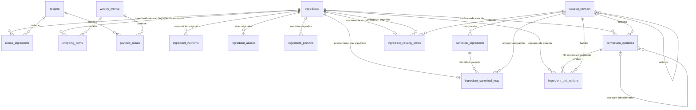

# 03 — Diseño del catálogo canónico compatible

Estado: **propuesta de diseño verificada en SQLite de escritorio; no implementada en Android**. Fecha: 2026-11-16. Rama `Development`, HEAD `c3ff612004229d7d9c57a3fbff6bf7ad8ce405c2`. Room vigente: esquema **8**, biblioteca 2.8.4. No se han cambiado IDs, recetas, nutrientes, assets, Kotlin, Gradle ni esquemas exportados de Room.

Decisión: añadir una capa de identidad y presentación sobre `ingredients`. Una receta sigue apuntando a una **fila nutricional concreta** mediante `ingredientId`; nunca a un promedio ni al representante cambiante de una identidad canónica.

Entregables relacionados:

- [ADR-0001: identidad canónica aditiva](adr/0001-additive-canonical-catalog.md).
- [Propuesta incremental de migración](03-canonical-migration-proposal.md).
- [DDL completo, tipos, restricciones e índices](fixtures/03-canonical-schema.sql), especificación ejecutable, fuera de `app/`.
- [Verificador y fixtures reproducibles](fixtures/verify_canonical_design.py).
- [Resultado de ejecución](03-design-verification.json).

## 1. Evidencia y límites de partida

| Fuente real | Hecho que condiciona el diseño |
| --- | --- |
| `app/src/main/java/com/zame/nutrinest/data/local/entity/IngredientEntity.kt` | IDs locales Long; cuatro macros por 100 g; `prepState`, `densityGml`, `sourceKey`, `isCustom`; `sourceKey` no tiene UNIQUE |
| `app/src/main/java/com/zame/nutrinest/data/local/entity/FoodDataEntities.kt` | Nutrientes, porciones y alias pertenecen a `ingredientId`; borrar el ingrediente los elimina por CASCADE; definición de nutrientes global por tag |
| `app/src/main/java/com/zame/nutrinest/data/local/entity/RecipeEntity.kt` | `recipe_ingredients` tiene PK `(recipeId,ingredientId)`; gramos persistidos y `quantityUnit` de presentación; ingrediente con FK RESTRICT |
| `app/src/main/java/com/zame/nutrinest/data/local/entity/MenuEntities.kt` | `shopping_items.ingredientId` con RESTRICT; menús apuntan a recetas; `factor` y `baseFactor` separados |
| `app/src/main/java/com/zame/nutrinest/data/local/NutriNestDatabase.kt` | v8; migraciones consecutivas 1→8; `onOpen` llama al importador y después al seeder |
| `app/src/main/java/com/zame/nutrinest/data/local/FoodDatabaseImporter.kt` | Offset BEDCA 1 000 000; reserva autoincremental desde 2 000 000; puede borrar filas importadas no referenciadas; borra tablas de referencia; inserta datos con OR IGNORE |
| `app/src/main/java/com/zame/nutrinest/data/local/BuiltInRecipeSeeder.kt` | Biblioteca v3; resuelve `sourceKey` sin unicidad; una versión posterior puede borrar/reinsertar enlaces de recetas existentes |
| `app/src/main/java/com/zame/nutrinest/data/local/dao/IngredientDao.kt` | La edición completa sustituye nutrientes/porciones/alias; los IDs de porción no son referencias históricas estables |
| `app/schemas/com.zame.nutrinest.data.local.NutriNestDatabase/8.json` | Esquema real utilizado por los fixtures; 20 tablas; identityHash `ecc15b80d9b578168273e8a9dae8d66d` |
| [Fase 01](01-baseline-audit.md) y [fase 02](../catalog/02-food-audit.md) | Arquitectura auditada y clasificación conservadora, no decisiones de consolidación autorizadas |

Asset `app/src/main/assets/nutrinest_foods.db`, dataset `2026.07.29`, SHA-256 `66682591bb5ae18bd53f7b0d9f720718e3dd42abe81fc08a2d90e2141da90359`: 936 alimentos, 924 activos, 12 obsoletos, 923 importables. Las 250 recetas integradas usan 122 IDs BEDCA distintos en 1421 enlaces. La fase 02 encontró **cero duplicados exactos demostrados**, dos pares ambiguos y diferencias de macros en los doce reemplazos declarados. Ninguna de estas cifras justifica una fusión automática.

Las cifras del asset no son un censo de una instalación del usuario. Una instalación puede conservar versiones antiguas, ingredientes personalizados y registros editados con `sourceKey` BEDCA. No se ha abierto ninguna base de usuario.

## 2. Identidad, composición y unidades: contratos

1. `ingredients.id` identifica una composición histórica concreta. `ingredients.kcal/carbs/fats/protein` e `ingredient_nutrients` siguen siendo la fuente de cálculo. No se trasladan a la tabla canónica.
2. `canonical_id` es un identificador opaco estable, nunca un nombre traducido ni un ID BEDCA. Agrupa únicamente registros cuya identidad alimentaria se haya revisado; el grupo puede contener muestras diferentes, que se siguen mostrando como variantes nutricionales seleccionables.
3. La clave semántica canónica es `(scope, concepto, parte, preparación, conservación, forma, formulación, variante)`. Todos sus componentes son no nulos. `UNSPECIFIED` significa desconocido, no crudo, fresco, sin sal ni equivalente.
4. Un registro tiene exactamente un mapeo y un estado al publicar una revisión. PK/FK garantizan **a lo sumo uno**; la comprobación transaccional de cobertura exige **al menos uno**. Una fila sin mapeo no puede publicarse; la lectura histórica por ID conserva un fallback sin JOIN obligatorio.
5. Un grupo canónico no tiene un `preferredIngredientId` implícito. Si contiene varias muestras, el selector muestra las alternativas y persiste la elección concreta. No usar `MIN(id)`, último importado ni mayor completitud como sustitución silenciosa.
6. Gramos siguen siendo la magnitud persistida. Una conversión nueva exige evidencia ligada al mismo `ingredientId` y a una unidad inequívoca. Nunca se propaga una densidad o peso por pertenecer al mismo grupo.
7. No se usa `INSERT OR REPLACE` en identidades, mapeos o filas nutricionales: su semántica de reemplazo puede activar borrados. Las mutaciones permitidas se expresan con INSERT/UPDATE explícitos en una transacción.

## 3. Entidades propuestas

Se conservan los seis nombres solicitados. `catalog_revision`, en singular, expresa el registro de una revisión y se mantiene por coherencia con el encargo. Todas las PK de texto llevan `NOT NULL` explícito. `TEXT` usa comparación BINARY; nombres normalizados **no** son claves únicas. Tiempos: epoch milliseconds UTC; hashes: SHA-256 hexadecimal minúsculo. Ninguna tabla nueva referencia `ingredient_categories`, `shopping_aisles` o `nutrient_defs`, que el importador actual elimina y repuebla.

Los tipos y CHECK exhaustivos están en el DDL enlazado. Las siguientes tablas definen el significado de **todas** sus columnas; `?` indica nullable.

### 3.1 `canonical_ingredients`

| Columnas | Tipo y significado |
| --- | --- |
| `canonical_id` | TEXT PK; UUID persistido; los prefijos legibles de los ejemplos son ilustrativos |
| `scope_key` | TEXT; `global` o `local:<installation_uuid>`; separación de personalizados |
| `concept_key` | TEXT; concepto controlado, por ejemplo `chicken_egg`, `brown_rice`; provisional `legacy:<ingredientId>` |
| `part_key` | TEXT; `WHOLE`, `WHITE`, `YOLK`, `EDIBLE`, `UNSPECIFIED`; vocabulario versionado |
| `preparation_key` | TEXT; RAW/BOILED/etc.; UNSPECIFIED cuando no está acreditado |
| `preservation_key` | TEXT; FRESH/CANNED/FROZEN/DRIED/CURED/SMOKED/UNSPECIFIED |
| `form_key` | TEXT; WHOLE/GROUND/INFUSION/etc.; no deducir forma por similitud textual |
| `formulation_key` | TEXT; PLAIN/DECAFFEINATED/IN_OIL/WITH_BUTTER/etc.; UNKNOWN se representa como UNSPECIFIED |
| `variant_key` | TEXT; identidad comercial/específica revisada; provisional `legacy:<ingredientId>`; nunca inventar un token para eludir un conflicto UNIQUE |
| `identity_state` | TEXT; PROVISIONAL o REVIEWED; no implica calidad nutricional |
| `name_es?`, `name_en?` | TEXT; al menos un nombre no vacío; originales bilingües se conservan en `ingredients` |
| `name_es_norm?`, `name_en_norm?` | TEXT; búsqueda, derivadas con algoritmo versionado |
| `created_revision_id`, `updated_revision_id` | TEXT FK a revisión de creación y última decisión editorial |

UNIQUE: clave semántica completa y `(canonical_id,scope_key)` para la FK compuesta del mapeo. Índices no únicos: nombres normalizados y ambas revisiones. No hay macros, precios, densidades ni pesos.

### 3.2 `ingredient_canonical_map`

| Columnas | Tipo y significado |
| --- | --- |
| `ingredient_id` | INTEGER PK y FK a `ingredients.id`; una asignación vigente por fila original |
| `canonical_id`, `scope_key` | TEXT; FK compuesta a la identidad canónica en ese ámbito |
| `source_namespace`, `source_record_key` | TEXT; identidad externa, p. ej. BEDCA / 904; personalizados `LOCAL:<installation_uuid>` / UUID lógico; procedencia no acreditada `LEGACY:<installation_uuid>` / ID local |
| `source_head_slot?` | INTEGER; 1 para la única cabecera acreditada de esa identidad externa; NULL en históricos, candidatos o casos ambiguos |
| `record_sha256` | TEXT; huella de la instantánea completa del registro, especificada abajo; no es UNIQUE |
| `mapping_basis` | TEXT; LEGACY_SINGLETON / REVIEWED / LOCAL |
| `origin_revision_id` | TEXT FK; revisión que capturó esta instantánea, inmutable |
| `assigned_revision_id` | TEXT FK; revisión que decidió el mapeo actual o cambió su cabecera |

UNIQUE `(source_namespace,source_record_key,source_head_slot)` permite múltiples históricos NULL y como máximo una cabecera 1. No exige una cabecera cuando la identidad está en conflicto. Índices: `(canonical_id,scope_key)` y las dos revisiones. La clave externa no se vuelve única en `ingredients.sourceKey`, porque hay registros históricos legítimos y personalizados editados que la conservan.

`record_sha256` no incluye favoritos, frecuencia, imagen ni fechas de uso. Incluye nombres originales, categoría, preparación, seguridad, naturaleza líquida, densidad, porciones/alias con contenido ordenado, cuatro macros y panel por tag, NULL explícitos, unidades/definiciones originales y procedencia conocida. Serialización `record-v1`: JSON UTF-8 con claves ordenadas, Unicode NFC, arrays ordenados por sus claves de contenido, números finitos en representación canónica documentada y misma implementación en productor/consumidor. No redondear nutrientes. Debe haber vectores dorados Kotlin/Python antes de publicar; el fixture usa una huella simplificada de la fila para probar restricciones, no implementa este algoritmo de producción.

Cambios editoriales de identidad actualizan el mapeo, no los ingredientes ni enlaces. El manifiesto inmutable conserva antes/después para reconstruir decisiones. No se pretende que la tabla de mapeo actual sea por sí sola un historial temporal completo.

### 3.3 `ingredient_catalog_status`

| Columnas | Tipo y significado |
| --- | --- |
| `ingredient_id` | INTEGER PK y FK a ingrediente |
| `state` | TEXT; uno de los cinco estados de la sección 4 |
| `reason_code`, `detail` | TEXT; causa estable y justificación específica, no un nombre alternativo |
| `replacement_ingredient_id?` | INTEGER FK a ingrediente distinto; sugerencia documentada, **nunca redirección** |
| `revision_id` | TEXT FK a última decisión de estado |

Índices: `(state,ingredient_id)`, reemplazo y revisión. La PK evita varios estados simultáneos. El reemplazo no acredita equivalencia ni habilita un cambio de receta. Detectar ciclos de recomendaciones al publicar; si hay conflicto, mantener el enlace NULL y registrar revisión humana.

### 3.4 `conversion_evidence`

| Columnas | Tipo y significado |
| --- | --- |
| `evidence_id` | TEXT PK estable; evidencia ligada a una instantánea nutricional |
| `ingredient_id` | INTEGER FK a ingrediente |
| `unit_key` | TEXT; unidad específica, p. ej. `ML`, `UNIT:egg_m:edible`, `CAN:brand_size:drained`; no un UNIT genérico |
| `grams_per_unit?` | REAL; gramos por **una** unidad de `unit_key`; NULL si desconocidos; positivo y finito si informado |
| `mass_basis` | TEXT EDIBLE/GROSS/DRAINED/UNKNOWN; solo EDIBLE habilita conversión nutricional directa |
| `method` | TEXT LEGACY_PORTION/LEGACY_DENSITY/MEASURED/DOCUMENTED/USER_DECLARED |
| `status` | TEXT UNVERIFIED/ACCEPTED/REJECTED |
| `source_locator`, `source_excerpt` | TEXT; localizador estable con hash/ID/página y transcripción o instantánea del dato original |
| `conditions` | TEXT; preparación, talla, escurrido, temperatura conocida o desconocida, incertidumbre, método y limitaciones; no completar valores ausentes |
| `reviewed_by?`, `reviewed_at?` | TEXT / INTEGER; responsable identificable y fecha obligatorios al aceptar |
| `supersedes_evidence_id?` | TEXT; FK compuesta al mismo ingrediente/unidad; nueva evidencia sustituye editorialmente a la anterior sin borrarla |
| `revision_id` | TEXT FK; revisión que registró la evidencia |

UNIQUE `(evidence_id,ingredient_id,unit_key)` soporta FKs compuestas. Índices: `(ingredient_id,unit_key)`, predecesora compuesta y revisión. Aceptar exige masa conocida, base EDIBLE y responsable/fecha. GROSS o DRAINED se conservan como evidencia informativa: para convertir, otra evidencia debe documentar que los gramos corresponden a la fracción comestible de **ese** ingrediente. No inferir rendimiento bruto→comestible, ni crudo→cocido.

Las evidencias publicadas son append-only por contrato del repositorio: una corrección crea otra fila. La opción vigente puede apuntar a ella; el manifiesto conserva el enlace previo. El DDL comprueba estructura y tipos, no la veracidad científica ni la inmutabilidad frente a SQL privilegiado.

### 3.5 `ingredient_unit_options`

| Columnas | Tipo y significado |
| --- | --- |
| `option_id` | TEXT PK estable |
| `ingredient_id` | INTEGER FK a ingrediente |
| `unit_key` | TEXT; unidad inequívoca compartida con la evidencia |
| `unit_kind` | TEXT COUNT/VOLUME/PORTION |
| `label_es?`, `label_en?` | TEXT; al menos un rótulo no vacío |
| `evidence_id` | TEXT; FK compuesta `(evidence_id,ingredient_id,unit_key)` a evidencia |
| `enabled` | INTEGER booleano; intención editorial, supeditada a evidencia aceptada |
| `default_slot?` | INTEGER 1 o NULL; como máximo una preferencia por ingrediente; si 1 exige enabled=1 |
| `revision_id` | TEXT FK a última decisión sobre la opción |

UNIQUE `(ingredient_id,unit_key)` y `(ingredient_id,default_slot)`. Índices de evidencia compuesta y revisión. El factor no se duplica: se lee de `conversion_evidence`. No hay FK a `ingredient_portions.id`, porque el DAO actual los regenera; se registra ese ID como localizador histórico junto con su contenido y hash.

GRAM y KILOGRAM son conversiones dimensionales exactas integradas (1 y 1000 g), sin evidencia alimentaria ni fila artificial. Para ML se necesita una densidad acreditada en g/ml; para vasos/cucharas se necesita volumen explícito y evidencia del cálculo, no una suposición universal. Si falta evidencia, seguir ofreciendo masa.

### 3.6 `catalog_revision`

| Columnas | Tipo y significado |
| --- | --- |
| `revision_id` | TEXT PK; UUID |
| `revision_key` | TEXT UNIQUE; clave idempotente de operación, calculada a partir de entrada + reglas + ámbito |
| `parent_revision_id?` | TEXT FK a revisión anterior; NULL solo en baseline |
| `kind` | TEXT BASELINE/DATASET/REVIEW/USER_EDIT |
| `state` | TEXT STAGED/APPLIED/REJECTED |
| `source_namespace` | TEXT; fuente o ámbito de la decisión |
| `dataset_version?`, `source_sha256?` | TEXT; versión declarada y hash real del artefacto; NULL cuando no existe fuente verificable |
| `manifest_json`, `manifest_sha256` | TEXT; manifiesto completo y su SHA-256; no basta guardar solo un hash sin contenido recuperable |
| `rules_version`, `actor` | TEXT; reglas aplicadas y responsable |
| `created_at`, `applied_at?` | INTEGER; creación y publicación |
| `applied_seq?` | INTEGER positivo UNIQUE; orden global de publicaciones, NULL si no aplicada |

Índices: clave idempotente, secuencia única, padre y `(source_namespace,dataset_version)`. Un manifiesto contiene versión de formato, huella de entrada, IDs y huellas anteriores/nuevos, decisiones de mapeo/estado/unidad, evidencia y motivos, diccionario nutricional original y procedencia conocida. Para un BEDCA modificado localmente, registra esa condición sin atribuir su composición al asset actual.

Dentro de `BEGIN IMMEDIATE`, validar JSON y su hash, padre igual a última revisión aplicada y secuencia siguiente; publicar datos y marcador conjuntamente. STAGED→APPLIED o REJECTED; APPLIED es inmutable. La reversión editorial crea otra revisión que restaura mapeos/estados; no borra historia. No depender de JSON1 en Android: validar JSON en Kotlin. SQL comprueba FKs/forma básica, no el contenido del manifiesto ni su cadena.

### 3.7 Reglas referenciales comunes

**Todas** las FKs nuevas usan `ON DELETE RESTRICT ON UPDATE RESTRICT`, incluidas autorreferencias de revisión/evidencia. Se indexan las claves hijas, con PK o prefijo de índice cuando ya cubren la consulta. Nada nuevo ejecuta CASCADE sobre información histórica. Las FKs v8 de recetas, compras, nutrientes, porciones y menús permanecen intactas.

El uso deliberado de NULL en los índices de cabecera y preferencia sigue la semántica de UNIQUE de [SQLite CREATE TABLE](https://www.sqlite.org/lang_createtable.html). Las referencias compuestas requieren índices únicos en el padre y se declaran también en las entidades futuras, conforme a [Room ForeignKey](https://developer.android.com/reference/androidx/room/ForeignKey). No se usan índices parciales, tablas STRICT, columnas generadas, UPSERT moderno ni funciones de ventana en la especificación.

## 4. Estados y lectura

| Estado persistido | Catálogo y nuevas selecciones | Referencias existentes |
| --- | --- | --- |
| VISIBLE — visible | Lista principal; elegible mediante selección concreta | Disponibles y calculables |
| SECONDARY — secundario | Alternativas del grupo o búsqueda ampliada; selección explícita | Disponibles y calculables |
| HIDDEN — oculto | Fuera de lista y búsqueda ordinaria; sección administrativa recuperable | Detalle, edición de receta, menú y compras por ID funcionan |
| REVIEW_REQUIRED — requiere revisión | Cola de revisión; fuera de selección ordinaria hasta decisión | Se conservan y muestran aviso, sin sustitución |
| OBSOLETE — obsoleto | Archivo; no elegible como nuevo ingrediente ordinario | Se conservan con motivo y eventual alternativa informativa |

La visibilidad es por fila, no por grupo. Un grupo aparece en la lista principal si contiene al menos una fila VISIBLE; no aparece por tener una oculta. Un favorito antiguo oculto debe poder resolverse en favoritos/histórico con su aviso, sin volver a publicarlo. Estados no cambian `isFavorite`, `usageCount`, `quantityUnit`, gramos ni disponibilidad del ID.

REVIEW_REQUIRED no reemplaza los avisos de calidad existentes. Un dato puede seguir VISIBLE con un aviso nutricional; la revisión exige una decisión explícita sobre su elegibilidad. El backfill inicial no convierte automáticamente los 799 avisos ENERC en 799 ocultaciones.

Consulta propuesta para navegación principal (solo presentación):

```sql
SELECT DISTINCT c.canonical_id, c.name_es, c.name_en
FROM canonical_ingredients c
JOIN ingredient_canonical_map m ON m.canonical_id=c.canonical_id
JOIN ingredient_catalog_status s ON s.ingredient_id=m.ingredient_id
WHERE s.state='VISIBLE';
```

Consulta histórica y cálculo, **sin filtro de estado**:

```sql
SELECT i.*, ri.grams, ri.quantityUnit, s.state
FROM recipe_ingredients ri
JOIN ingredients i ON i.id=ri.ingredientId
LEFT JOIN ingredient_catalog_status s ON s.ingredient_id=i.id
WHERE ri.recipeId=:recipeId;
-- Total = SUM(i.kcal * ri.grams / 100); análogo para cada macro.
```

Consulta de conversión: `ingredient_unit_options` JOIN `conversion_evidence` por las tres columnas de la FK, filtrando `enabled=1 AND status='ACCEPTED' AND mass_basis='EDIBLE'`. El validador de publicación rechaza una opción enabled con evidencia no aceptada, aunque las FKs por sí solas permitan esa combinación. Esta defensa se mantiene también al leer.

## 5. Ejemplos y clasificación inequívoca

Los nombres semánticos siguientes ilustran el modelo; **no publican nuevos mapeos ni acreditan pesos**. Los IDs BEDCA que se citan sí se han comprobado en el asset. ID local legado habitual = 1 000 000 + ID BEDCA; no usar esa fórmula como resolver universal de futuras versiones.

| Caso | Representación propuesta y límite |
| --- | --- |
| Huevo de gallina entero / clara / yema | Concepto `chicken_egg`, partes WHOLE/WHITE/YOLK distintas. BEDCA 1173 clara RAW y 2125 yema RAW permanecen separados; 2126 entero BOILED tampoco se mezcla con RAW. El asset no contiene una fila llamada huevo de gallina entero crudo: ese ejemplo es conceptual, no se inventa un ID ni se usa huevo de codorniz como sustituto |
| Yema desecada 762 | Mantener singleton provisional: nombre indica desecada pero prep_state es UNSPECIFIED; revisión explícita antes de asignar DRIED. No reutilizar los 18 g de la yema fresca por similitud de rótulo |
| Arroz integral 904 / 1009 | Mismo concepto de familia, identidades RAW y BOILED distintas. No deducir rendimiento por cocientes de kcal, agua o gramos |
| Tomate 2421 / conserva 481 y 2423 | 2421 trae UNSPECIFIED: no marcar FRESH/RAW sin revisión. 481 y 2423 son ambos CANNED, pero tienen diferencias y permanecen singleton mientras no se acredite identidad. FRESH frente CANNED se distingue por conservación; CANNED no acredita un método térmico concreto |
| Café 2433 / descafeinado 2434 | Formulación REGULAR frente DECAFFEINATED; el panel idéntico observado no elimina la diferencia |
| Huevo revuelto con mantequilla 761 | Formulación WITH_BUTTER, preparación y forma según evidencia. No agrupar como huevo entero simple |
| Personalizado | Ámbito `local:<uuid>` y clave externa `LOCAL:<uuid>/<logical_uuid>`; identidad propia. Un importado editado conserva su ID actual y sourceKey histórico, pero no se promueve automáticamente a cabecera BEDCA |
| Obsoleto 1216 → 2132 | Si 1216 existe en la instalación, mantener su ID y nutrientes, estado OBSOLETE y sugerencia 2132 solo si existe localmente. Los macros difieren; no migrar recetas al destino. Si el destino falta, NULL + referencia externa en manifiesto |
| Alias y traducciones | Nombres canónicos ES/EN con fallback al disponible; nombres originales intactos. Búsqueda puede unir `ingredient_aliases` a los mapeos y aplicar estado. Alias repetidos en varios alimentos son legales; no hay UNIQUE global ni identidad por alias |

Ejemplo de filas relacionadas (valores ilustrativos, hashes calculados durante implementación, no literales para producción):

```text
canonical_ingredients: canonical_id=C-rice-raw, scope=global,
  concept=brown_rice, part=WHOLE, preparation=RAW, preservation=UNSPECIFIED,
  form=GRAIN, formulation=UNSPECIFIED, variant=reviewed-reference,
  name_es=Arroz integral crudo, name_en=Raw brown rice, identity_state=REVIEWED
ingredient_canonical_map: ingredient_id=1000904, canonical_id=C-rice-raw,
  source_namespace=BEDCA, source_record_key=904, source_head_slot=1,
  record_sha256=<huella real>, origin_revision_id=R0, assigned_revision_id=R1
ingredient_catalog_status: ingredient_id=1000904, state=VISIBLE,
  reason_code=REVIEW_APPROVED, detail=<justificación>, revision_id=R1
conversion_evidence: evidence_id=E1, ingredient_id=1000904,
  unit_key=UNIT:unresolved, grams_per_unit=NULL, mass_basis=UNKNOWN,
  status=UNVERIFIED, method=DOCUMENTED, source_locator=<hallazgo>, revision_id=R1
ingredient_unit_options: option_id=O1, ingredient_id=1000904,
  unit_key=UNIT:unresolved, unit_kind=COUNT, evidence_id=E1,
  enabled=0, default_slot=NULL, label_es=Unidad sin peso acreditado, revision_id=R1
catalog_revision: revision_id=R1, parent_revision_id=R0, kind=REVIEW,
  state=APPLIED, applied_seq=2, revision_key=<idempotencia>,
  manifest_json=<decisión y evidencia>, manifest_sha256=<huella real>, actor=<responsable>
```

La opción sin masa sirve para documentar revisión; jamás convierte una cantidad. No se crea por defecto una opción UNIT para todos los alimentos.

Los alias problemáticos de la fase 02 (p. ej. alias de pasta asociados a tahini 2567) se conservan como evidencia original y no autorizan agrupaciones. El índice de búsqueda futuro puede excluirlos mediante una lista de decisiones `(ingredientId,lang,aliasNorm,hash_del_contenido)` en el manifiesto aplicado, sin borrar filas. La exclusión es versionada y reproducible; no una heurística nueva en cada búsqueda. No se añade una séptima tabla de alias canónicos en esta fase porque ya existe `ingredient_aliases` por registro; una edición independiente de sinónimos canónicos requeriría otro ADR.

## 6. Importaciones posteriores y conservación

| Entrada o situación | Resultado obligatorio |
| --- | --- |
| Misma revisión/hash/reglas ya aplicada | No-op; no crear IDs, opciones o revisiones duplicados |
| Misma versión declarada, hash diferente | No tratarla como instalada; nueva revisión candidata con incidencia de procedencia |
| Fuente y contenido sin cambios | Reutilizar la fila concreta; registrar pertenencia a nueva entrega en manifiesto, sin cambiar origen |
| Misma identidad externa, composición/medidas/alias originales cambiados | Crear nueva fila `ingredients` con ID autogenerado fuera de la reserva histórica, conservar anterior y sus hijos. Nueva cabecera solo tras validación; elección canónica revisada o singleton nuevo |
| Se acredita identidad pero cambian preparación/parte/conservación/formulación | Identidad canónica distinta. Se puede conservar la familia `concept_key`; ninguna conversión de rendimiento implícita |
| Dos filas candidatas para la misma cabecera | Conflicto explícito; no escoger la última. Conservar ambas, no publicar cambio de cabecera y abrir revisión |
| Fuente omite un alimento | Si la entrega se declara completa y válida, marcar OBSOLETE mediante revisión; si es parcial, ausencia no implica baja. No borrar ingredientes |
| `replaced_by_id` de la fuente | Registrar sugerencia y causa, no remapear enlaces. Un cambio de macros impide asumir intercambiabilidad |
| Alimento nuevo | ID nuevo autogenerado, singleton provisional; VISIBLE solo si pasa contrato de elegibilidad explícito, en otro caso REVIEW_REQUIRED |
| Personalizado creado/editado | Fuente LOCAL y ámbito local. Tras activar inmutabilidad, una edición de composición/medidas crea nueva versión e ID; el ID anterior sigue en recetas. Cambiar enlaces requiere una acción distinta y explícita del usuario |
| Corrección del estado/nombre canónico | Solo capa editorial y revisión; composición original inalterada |

El offset queda como localizador histórico, no como estrategia de sobrescritura. Para nuevas filas, reservar secuencia al menos en el suelo existente de 2 000 000 y respetar el máximo ID ya presente; SQLite asigna el siguiente, nunca reciclar un ID retirado. `sourceKey` puede seguir siendo BEDCA:904 en varias versiones; el resolver nuevo utiliza el mapeo y la cabecera explícita, o una instantánea fijada.

Un cambio en `nutrient_defs.unit` podría reinterpretar valores antiguos sin tocarlos. Por ello se **congelan las definiciones existentes** para estos registros; se archivan sus unidades en el manifiesto baseline. Si una entrega redefine un tag con otra unidad/semántica, su publicación se rechaza hasta diseñar la versión de definiciones y su lector. No basta con añadir filas de ingredientes. La incidencia ENERC de la fase 02 (799 valores compatibles con kJ bajo definición kcal) sigue siendo una incidencia, no se corrige ni se certifica por este diseño. Una futura corrección debe conservar la instantánea anterior y mostrar qué versión se está utilizando.

Las recetas integradas existentes conservan sus enlaces y cantidades al importar catálogo. Nuevas recetas se resuelven contra un manifiesto de biblioteca que fija `(namespace,external_key,record_sha256)`; la cabecera no sustituye una instantánea requerida. Si falta o es ambigua, no marcar completada esa importación. Cambios de biblioteca que afecten recetas ya guardadas requieren un flujo separado. La implementación actual del seeder debe adaptarse antes de activar este contrato.

## 7. Diagrama de relaciones



La cardinalidad física 0..1 de mapeo/estado permite construir una transacción; la publicación exige 1. Las relaciones dobles de revisión se resumen gráficamente; el DDL contiene cada FK individual. Menús/perfiles/porciones personales siguen la estructura v8, sin FK canónica nueva.

## 8. Pruebas de diseño ejecutadas y pendientes

Comando reproducible desde la raíz, Windows:

```powershell
& C:\Python313\python.exe docs/architecture/fixtures/verify_canonical_design.py
```

En otro entorno con Python 3.10+: `python3 docs/architecture/fixtures/verify_canonical_design.py`. Solo crea SQLite `:memory:`; abre el asset con `mode=ro` y `query_only=ON`; escribe únicamente el JSON de evidencias en esta carpeta.

Resultado final: **55 comprobaciones, salida 0**, Python 3.13.7, SQLite 3.50.4. El fixture reconstruye las 20 tablas de `8.json`, carga 936 alimentos reales y 31 696 nutrientes, porciones y alias originales, añade un personalizado sintético y enlaza siete ingredientes a receta/compras. Incluye a propósito los obsoletos y el excluido; no pretende reproducir los 923 importables de una instalación nueva.

Se verifican: seis tablas añadidas sin alterar DDL/índices previos; backfill sin cambios en las 20 tablas; PK y firma canónica únicas; partes del huevo, preparaciones de arroz, conservación y descafeinado distintos; ámbito local aislado; FK de ingredientes/canon/revisión/evidencia; cabecera única con varios históricos NULL; cobertura obligatoria mediante validador; estados y referencias antiguas; rechazo de asignación RAW→BOILED por validador; vínculo de evidencia a ingrediente/unidad; masa inválida; una sola opción por unidad y preferencia; opciones no acreditadas bloqueadas; cambio de cabecera sin reescritura de enlaces; nutrientes/porciones/alias intactos; totales exactamente iguales; rollback completo ante fallo intermedio; `foreign_key_check` vacío; `integrity_check=ok`; hash del asset idéntico.

La aceptación de una porción en el fixture es **simulada** para probar la máquina de estados. No acredita científicamente su peso comestible. Los fixtures usan nombres/valores explícitamente marcados como prueba y no salen de memoria.

Durante preparación hubo dos ejecuciones con salida 1 por supuestos del arnés: entidades exportadas sin propiedad `indices`, y nombre de tabla `categories` en lugar de `food_categories`. Se corrigió el arnés; no hubo fallos de una migración Android porque no se ejecutó ninguna. La ejecución intermedia de 53 casos pasó; tras ampliar ejemplos y aislar la prueba de idempotencia, la final tiene 55.

**No ejecutado en fase 03:** Gradle, emulator/device, `MigrationTestHelper`, SQLite de API 26, concurrencia real Room, recomposición Compose, creación inicial Room ni importador/seeder futuros. Las pruebas Python no validan KSP, CHECK/triggers en instalaciones nuevas, `room_master_table`, callbacks ni el algoritmo de fingerprint multiplataforma. El plan de fase 04 exige esas verificaciones antes de habilitar la capa.

## 9. Riesgos, decisiones pendientes y fase 04

| Gravedad | Riesgo | Decisión / requisito |
| --- | --- | --- |
| Crítica | Importador borra filas que las nuevas FKs retienen; fallo absorbido en `onOpen` | Adaptar importador en la misma entrega que v9; probar reapertura con dataset distinto |
| Crítica | Seeder resuelve `sourceKey` ambiguo y sustituye enlaces existentes | Resolver instantáneas fijadas; conservar recetas guardadas; no publicar parcialmente |
| Alta | Fusión por nombre/panel igual confunde preparación, parte o formulación | Singleton por defecto; revisión con evidencia de identidad, sin reasignación de referencias |
| Alta | Definiciones globales reinterpretan nutrientes históricos | Congelar semántica de tags y archivar unidades; bloquear entregas incompatibles |
| Alta | Medida heredada parece acreditada aunque no lo está | Evidencia UNVERIFIED, opción deshabilitada; masa disponible; no inventar densidades |
| Alta | CHECK no equivalente en creación fresca y migrada de Room | Implementar enforcement común y probar ambas rutas en API 26; no aprobar por SQLite desktop |
| Alta | Edición actual muta composición y recrea hijos | Versionado por copia para cambios de datos después de activar la capa; pruebas de regresión de editor |
| Media | Cobertura, cadena de revisión o semántica no garantizadas por FK | Validador transaccional completo; manifiesto verificado; escritores centralizados |
| Media | Catálogo crece por instantáneas históricas y manifiestos | Medir tamaño/latencia; no purgar historia dentro de esta normalización |
| Media | Nuevos filtros ocultan favoritos o históricos | Consultas históricas por ID, independientes del selector canónico |
| Media | Copias manuales de base mezclan ámbitos locales o IDs | UUID de instalación estable, reglas de restauración fuera de esta migración |

Antes de fase 04 hay que aprobar el vocabulario y quién revisa identidades/evidencias, fijar vectores del fingerprint, concretar la experiencia de edición por copia y la lista editorial inicial. No es necesario decidir ahora una fusión: el baseline 1:1 permite migrar conservadoramente. Resolver la unidad ENERC es una tarea separada de calidad, no requisito para modificar silenciosamente nutrientes.

La propuesta incremental y los criterios de publicación están en el documento de migración. Checkpoint Git recomendado, **no creado**: `docs: canonical food catalog design`.
